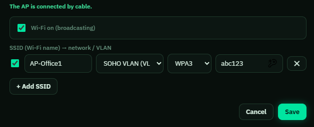
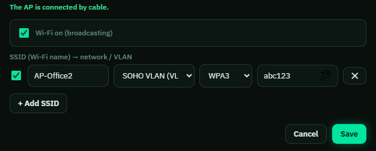
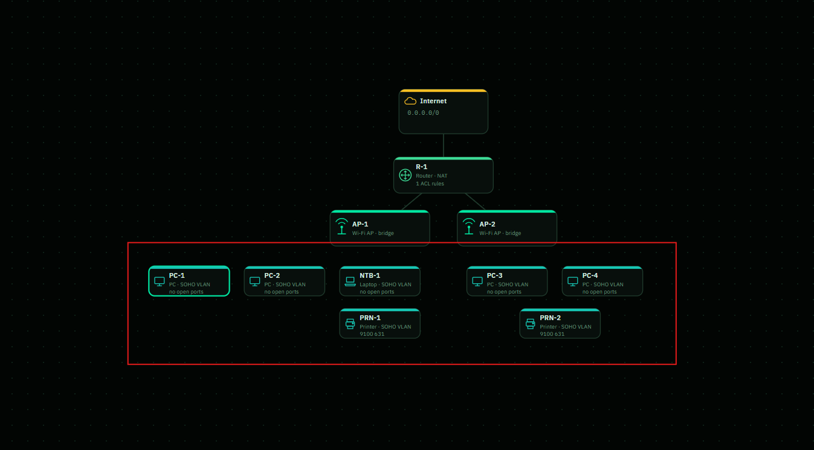
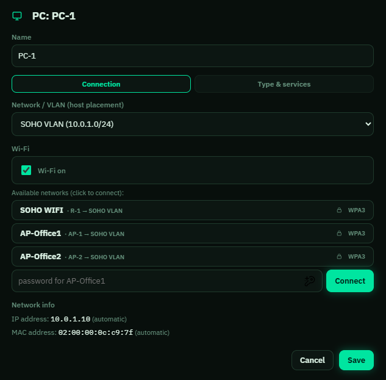
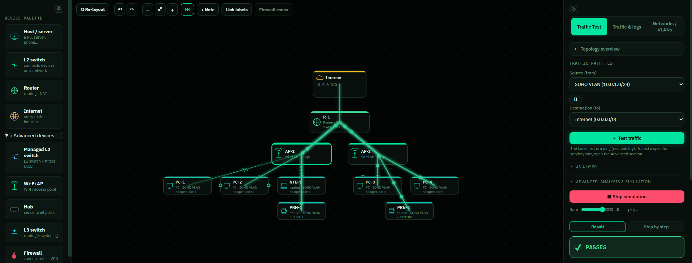
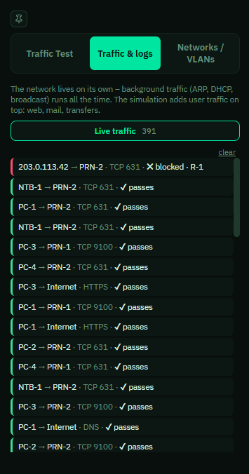

# SOHO Network Lab

A hands-on SOHO network simulation exploring network configuration, wireless connectivity, VLANs, NAT, ACLs, and traffic analysis.

## Setting up a VLAN
I'm going to set up this network without a switch. Instead, I'll use two wireless access points (AP's), one for each office room. 
I'll also create a VLAN called "SOHO VLAN", using the subnet 10.0.1.0/24 and VLAN ID 10. Both access points and their connected devices will belong to this network.
I chose to use two access points to simulate wireless coverage in two separate office rooms.

## Setting up the router
Before anything else, I checked and verified that Wi-Fi Broadcasting was on.
I configured the SSID, picked the VLAN I just created, WPA3 and chose a password for the Wi-Fi "abc123" for demonstration purposes I'll use this password.
I used WPA3 since It's the latest Wi-Fi security protocol and is designed to replace WPA2 with stronger network protection against offline password guessing.

##Configuring the Router ACL
I configured an ACL (Access Control List) on the router to control network traffic.
The rule allows devices on my SOHO VLAN to communicate with the internet using any IP protocol.
I also changed the default policy to "deny any", meaning any routed traffic that doesn't match an allowed rule will be blocked.
This follows the principle of default deny, where only explicitly permitted traffic is allowed through.

## Setting up and configuring wireless access point's
I first started with connecting the wireless access point's (AP-1 and AP-2) to the router using wired connecting to ensure there is communication between them. 
Each AP represents a separate office room and provide wireless connectivity to devices in that area.

For AP-1 I enabled Wi-Fi broadcasting, configured the SSID as AP-Office1, selected SOHO VLAN, and enabled WPA3 using the same demonstration password.
The access point operates as a bridge, allowing wireless devices to connect to the existing office network.

I configured AP-2 using the same settings as AP-1, but with a different SSID (AP-Office2) to represent the second office room.
Both access points belong to the same SOHO VLAN, so devices connected to either AP are part of the same network.

## Installing & configuring hosts
I added several hosts to represent computers, laptops and printers in two separate office rooms.

Each host needs to be connected to the right wireless access point specific to that office room. So here for example, I'm connecting "PC-1" to "AP-Office1" using the Wi-Fi password I configured earlier. 
DHCP assigns IP addresses to each host automatically. I repeated this process for every host but decided not to include every screenshot since the configuration process is essentially the same.

## Network Testing & Traffic Analysis
Once all devices were configured and connected, I ran a traffic simulation to verify that the network was functioning correctly. 
The test showed that traffic from my SOHO VLAN could successfully reach the internet.

The logs showed successful communication between hosts and printers, as well as outbound internet access through DNS, HTTP and HTTPS.
The router also blocked unsolicited inbound traffic to the network using NAT.
Overall, the tests confirmed that the network was functioning as intended.

## What I Learned:
This project helped me put my networking knowledge into practice.
I gained hands-on experience configuring VLANs, wireless access points, WPA3 security, and router ACL rules.
I also improved my understanding of NAT, DHCP, and how to troubleshoot and verify network connectivity using traffic simulations and logs.
